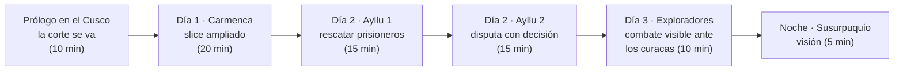
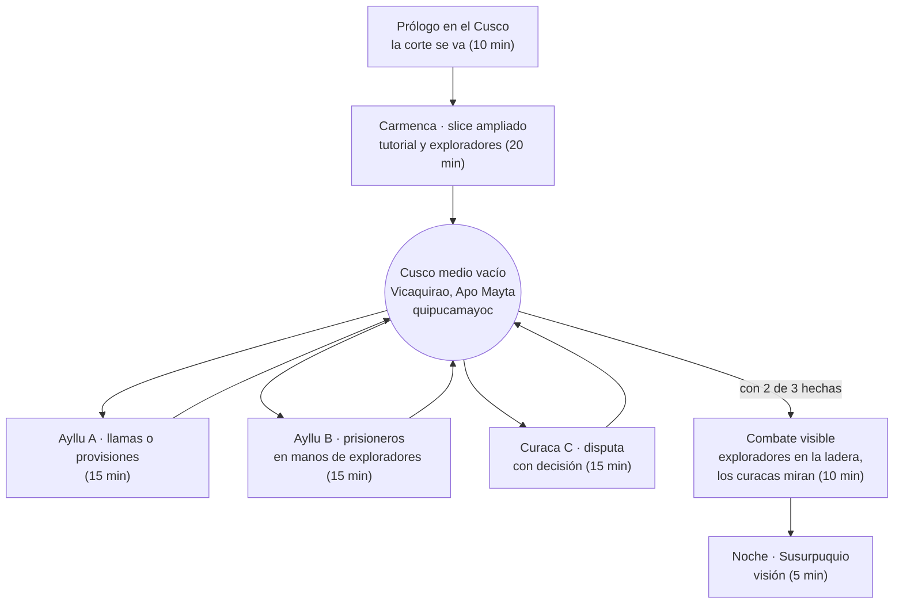
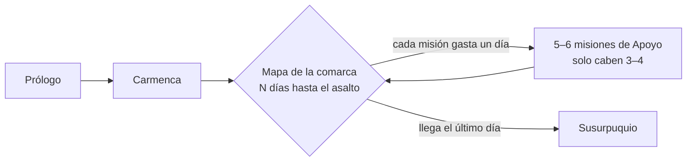

# Capítulo I — El Cusco abandonado

**Estado:** propuestas de estructura (F7, tarea 3), pendientes de que el desarrollador elija.
Canon: `HISTORICAL_REFERENCES.md` y `DECISIONS/0017`. Base: GDD §8, §9 y §20.

## 1. Lo que el capítulo tiene que contar

Duración objetivo: **1–2 horas** (GDD §9), publicable como demo (GDD §20). Ese es el hilo
fijo, según GDD §9 y las crónicas:

1. **Llegan noticias del avance chanca.** Uscovilca acampa en Vilcaconga, a siete leguas.
2. **Viracocha y Urco se retiran** a Caquia Xaquixaguana y la ciudad se vacía.
3. **Cusi se queda** con Vicaquirao y Apo Mayta (y Quilescachi Urco Guaranga, solo en el
   códice).
4. **Tutorial** y primeras escaramuzas con exploradores chancas: es el slice.
5. **Apoyo:** los curacas vecinos solo ayudarán si Cusi demuestra que tiene gente (Betanzos,
   cap. VII). Hay que ganárselos.
6. **Cierre:** la noche antes del asalto, la visión en Susurpuquio, con el cristal y la
   figura ambigua.

El capítulo termina **antes** del asalto, que es el Capítulo II. Lo que se gane en Apoyo
cambia esa batalla (GDD §8.2).

## 2. Lo que ya existe y se reutiliza

- **El slice entero** (unos 10 min): Carmenca, el entrenamiento, la huaca, la decisión de las
  llamas, las escaramuzas y el paso.
- **Sistemas:**
  - combate completo;
  - director del slice (pasos REACH, ENCOUNTER, DIALOGUE, RITE, CHOICE, DRILL);
  - diálogos, códice, checkpoints, objetivos con marcador y resumen de partida.
- **Personajes:** Cusi, Vicaquirao, comunero y familia, y el guerrero chanca, que pasará a
  llevar lanza larga (`0017`).

## 3. Tres estructuras posibles

Las tres cuentan lo mismo. Cambian en cómo se recorre el capítulo y en cuánto cuesta.

### A · Lineal: «Tres jornadas» (la más barata)

Una secuencia fija por días, como el slice pero más larga.

- **Duración:** unos 75 min.
- **Escenarios nuevos:**
  - calles del Cusco (prólogo);
  - 2 zonas de ayllu (variantes del kit de Carmenca);
  - la fuente de Susurpuquio.
- **Apoyo:** cada ayllu pasa a Simpatizante o Aliado según cómo se resuelva su misión.
- **A favor:**
  - usa tal cual el director del slice;
  - es el riesgo más bajo y el más fácil de probar con jugadores.
- **En contra:**
  - el jugador no elige el orden;
  - el Apoyo se siente menos «político».

### B · Cusco como centro: «Ganarse a los curacas» (equilibrio; recomendada)

Tras el prólogo, el Cusco medio vacío es un **centro** desde el que se sale a 3 misiones de
Apoyo **en el orden que el jugador quiera**. Carmenca (el slice) es la primera, obligatoria.

- **Duración:** unos 90–100 min.
- **Escenarios nuevos:**
  - el Cusco como centro pequeño (plaza y calles de pirca y adobe);
  - 3 zonas de misión: 2 reutilizan el kit de Carmenca y 1 es nueva;
  - Susurpuquio.
- **Apoyo:** se ve en el centro: gente que vuelve, curacas que mandan hombres. Es la base de
  la batalla del Capítulo II.
- **Novedades de sistema:**
  - estado del Apoyo por ayllu;
  - misiones que se abren y se cierran;
  - guardado entre escenas.

  El director del slice sirve para cada misión.
- **A favor:**
  - es la estructura del GDD §8.2 (Neutral → Simpatizante → Aliado);
  - «demostrar que tiene gente» es literalmente lo que cuenta Betanzos;
  - el orden libre da sensación de decisión sin un mundo abierto.
- **En contra:**
  - más escenario y un sistema de misiones nuevo;
  - unas 3–4 semanas más que la A.

### C · Contrarreloj: «Siete leguas» (la más ambiciosa)

El ejército chanca avanza día a día desde Vilcaconga. Hay más misiones de las que caben
antes del asalto: el jugador **elige a quién ayudar** y pierde al resto. Mapa de la comarca
con el avance chanca.

- **Duración:** unos 90–120 min por partida, y rejugable.
- **Escenarios nuevos:** los de B, más 2–3 zonas de misión.
- **Novedades de sistema:** todo lo de B, más el mapa, el reloj de días y el avance chanca
  visible.
- **A favor:** la tensión de la huida y del cerco se juega, no se cuenta; tiene mucha
  identidad.
- **En contra:**
  - el doble de contenido que B;
  - arriesga el plazo de la demo;
  - cuesta probarlo y equilibrarlo con un solo desarrollador.

## 4. Comparación

| | A · Lineal | B · Centro (recomendada) | C · Contrarreloj |
| --- | --- | --- | --- |
| Duración | ~75 min | ~90–100 min | ~90–120 min |
| Escenarios nuevos | 4 | 5 | 7–8 |
| Sistemas nuevos | Apoyo por ayllu | + misiones, centro, guardado | + mapa, reloj, avance chanca |
| Riesgo de plazo | Bajo | Medio | Alto |
| Fidelidad al GDD §8.2 | Parcial | Completa | Completa y ampliada |

La estimación en semanas la da el plan de producción (tarea 6), después de medir los
sistemas (tarea 4) y el arte (tarea 5).

## 5. Comunes a las tres

- **Ritmo:** se alternan combate, exploración y Apoyo cada 10–15 min. Ninguna parte pasa
  de 20 min sin combate.
- **Huacas:** 2–3 en el capítulo (GDD §8.4), con su ofrenda, una visión breve y una mejora
  pequeña. La de Carmenca ya existe.
- **Enemigos:** exploradores chancas (el guerrero, con lanza larga). Honderos y escuderos
  quedan para el Capítulo II (GDD §7).
- **Quipucamayoc:** el narrador (GDD §5.2) puede presentar cada jornada y dar la información
  de los quipus (§8.3). Su nombre está por decidir.
- **Lo sobrenatural:** solo la visión de la huaca y la de Susurpuquio (GDD §3.3).
