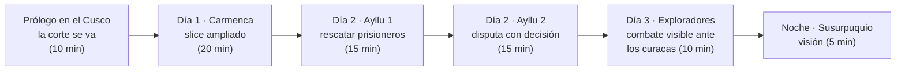
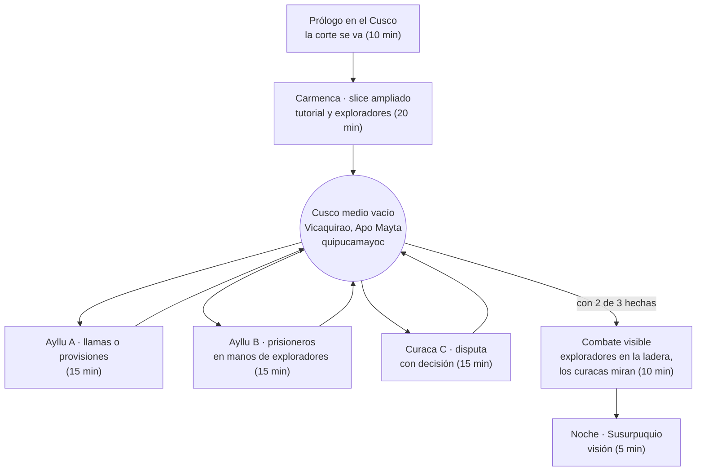
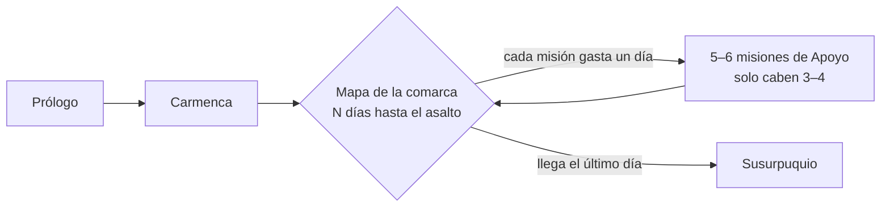

# Capítulo I — El Cusco abandonado

**Estado:** estructura **B · Cusco como centro**, elegida por el desarrollador el
2026-11-24 (F7, tarea 3). A y C se conservan abajo como alternativas descartadas.
Canon: `HISTORICAL_REFERENCES.md` y `DECISIONS/0017`. Base: GDD §8, §9 y §20.

## 1. Lo que el capítulo tiene que contar

Duración objetivo: **1–2 horas** (GDD §9), publicable como demo (GDD §20). Ese es el hilo
fijo, según GDD §9 y las crónicas:

1. **Llegan noticias del avance chanca.** Uscovilca acampa en Vilcaconga, a siete leguas.
2. **Viracocha y Urco se retiran** a Caquia Xaquixaguana y la ciudad se vacía.
3. **Cusi se queda** con Vicaquirao y Apo Mayta (y Quilescachi Urco Guaranga, solo en el
   códice).
4. **Tutorial** y primeras escaramuzas con exploradores chancas: es el slice.
5. **Apoyo:** los curacas vecinos solo ayudarán si Cusi demuestra que tiene gente (Betanzos,
   cap. VII). Hay que ganárselos.
6. **Cierre:** la noche antes del asalto, la visión en Susurpuquio, con el cristal y la
   figura ambigua.

El capítulo termina **antes** del asalto, que es el Capítulo II. Lo que se gane en Apoyo
cambia esa batalla (GDD §8.2).

## 2. Lo que ya existe y se reutiliza

- **El slice entero** (unos 10 min): Carmenca, el entrenamiento, la huaca, la decisión de las
  llamas, las escaramuzas y el paso.
- **Sistemas:**
  - combate completo;
  - director del slice (pasos REACH, ENCOUNTER, DIALOGUE, RITE, CHOICE, DRILL);
  - diálogos, códice, checkpoints, objetivos con marcador y resumen de partida.
- **Personajes:** Cusi, Vicaquirao, comunero y familia, y el guerrero chanca, que pasará a
  llevar lanza larga (`0017`).

## 3. Tres estructuras posibles

Las tres cuentan lo mismo. Cambian en cómo se recorre el capítulo y en cuánto cuesta.

### A · Lineal: «Tres jornadas» (la más barata)

Una secuencia fija por días, como el slice pero más larga.

- **Duración:** unos 75 min.
- **Escenarios nuevos:**
  - calles del Cusco (prólogo);
  - 2 zonas de ayllu (variantes del kit de Carmenca);
  - la fuente de Susurpuquio.
- **Apoyo:** cada ayllu pasa a Simpatizante o Aliado según cómo se resuelva su misión.
- **A favor:**
  - usa tal cual el director del slice;
  - es el riesgo más bajo y el más fácil de probar con jugadores.
- **En contra:**
  - el jugador no elige el orden;
  - el Apoyo se siente menos «político».

### B · Cusco como centro: «Ganarse a los curacas» (**elegida**)

Tras el prólogo, el Cusco medio vacío es un **centro** desde el que se sale a 3 misiones de
Apoyo **en el orden que el jugador quiera**. Carmenca (el slice) es la primera, obligatoria.

- **Duración:** unos 90–100 min.
- **Escenarios nuevos:**
  - el Cusco como centro pequeño (plaza y calles de pirca y adobe);
  - 3 zonas de misión: 2 reutilizan el kit de Carmenca y 1 es nueva;
  - Susurpuquio.
- **Apoyo:** se ve en el centro: gente que vuelve, curacas que mandan hombres. Es la base de
  la batalla del Capítulo II.
- **Novedades de sistema:**
  - estado del Apoyo por ayllu;
  - misiones que se abren y se cierran;
  - guardado entre escenas.

  El director del slice sirve para cada misión.
- **A favor:**
  - es la estructura del GDD §8.2 (Neutral → Simpatizante → Aliado);
  - «demostrar que tiene gente» es literalmente lo que cuenta Betanzos;
  - el orden libre da sensación de decisión sin un mundo abierto.
- **En contra:**
  - más escenario y un sistema de misiones nuevo;
  - unas 3–4 semanas más que la A.

### C · Contrarreloj: «Siete leguas» (la más ambiciosa)

El ejército chanca avanza día a día desde Vilcaconga. Hay más misiones de las que caben
antes del asalto: el jugador **elige a quién ayudar** y pierde al resto. Mapa de la comarca
con el avance chanca.

- **Duración:** unos 90–120 min por partida, y rejugable.
- **Escenarios nuevos:** los de B, más 2–3 zonas de misión.
- **Novedades de sistema:** todo lo de B, más el mapa, el reloj de días y el avance chanca
  visible.
- **A favor:** la tensión de la huida y del cerco se juega, no se cuenta; tiene mucha
  identidad.
- **En contra:**
  - el doble de contenido que B;
  - arriesga el plazo de la demo;
  - cuesta probarlo y equilibrarlo con un solo desarrollador.

## 4. Comparación

| | A · Lineal | B · Centro (recomendada) | C · Contrarreloj |
| --- | --- | --- | --- |
| Duración | ~75 min | ~90–100 min | ~90–120 min |
| Escenarios nuevos | 4 | 5 | 7–8 |
| Sistemas nuevos | Apoyo por ayllu | + misiones, centro, guardado | + mapa, reloj, avance chanca |
| Riesgo de plazo | Bajo | Medio | Alto |
| Fidelidad al GDD §8.2 | Parcial | Completa | Completa y ampliada |

La estimación en semanas la da el plan de producción (tarea 6), después de medir los
sistemas (tarea 4) y el arte (tarea 5).

## 5. Comunes a las tres

- **Ritmo:** se alternan combate, exploración y Apoyo cada 10–15 min. Ninguna parte pasa
  de 20 min sin combate.
- **Huacas:** 2–3 en el capítulo (GDD §8.4), con su ofrenda, una visión breve y una mejora
  pequeña. La de Carmenca ya existe.
- **Enemigos:** exploradores chancas (el guerrero, con lanza larga). Honderos y escuderos
  quedan para el Capítulo II (GDD §7).
- **Quipucamayoc:** el narrador (GDD §5.2) puede presentar cada jornada y dar la información
  de los quipus (§8.3). Su nombre está por decidir.
- **Lo sobrenatural:** solo la visión de la huaca y la de Susurpuquio (GDD §3.3).

## 6. Sistemas que pide la estructura B (F7, tarea 4)

Inventario del código actual frente a lo que pide la estructura B. **Nada se implementa en
F7:** esto sirve para el plan de producción (tarea 6).

**Tamaños:**
- **S:** 1–2 tareas, con lo que ya existe.
- **M:** un sistema nuevo pequeño o una ampliación clara; unas 3–5 tareas.
- **L:** sistema nuevo con varias piezas y pruebas de integración; más de 5 tareas.

Una tarea es lo que cabe en una tarde (AGENTS.md).

### 6.1. Lo que ya existe y basta (con contenido nuevo)

| Necesidad | Sistema actual | Qué falta | Tamaño |
| --- | --- | --- | --- |
| Guion de cada misión | `SliceDirector`, `SliceFlow` y `SliceStep` (REACH, ENCOUNTER, DIALOGUE, INTERACT, RITE, CHOICE, DRILL) con *flags* | Un `SliceSequence` por misión; quizá un paso nuevo (`ESCORT`, ver 6.2) | S |
| Diálogos y decisiones | `DialoguePlayer`, `ChoiceBox` | Textos (con `canon-check` en F8) | S |
| Escenarios con el kit | `SectorBuilder`, `SectorLayout`, `SectorDressing`, vegetación, fondo y navegación, todo generado | Un `SectorLayout` por zona: Cusco, 3 misiones, Susurpuquio, ladera del combate visible | S por zona (el coste está en el arte, tarea 5) |
| Gente en el Cusco | `SectorCrowd` y `SectorPeople` (gente con rutas, frases al pasar, distancia de dibujo) | Que la gente que aparece dependa del Apoyo | S |
| Huacas y mejoras | `HuacaRite` (ofrenda, visión, +resistencia) | 1–2 huacas nuevas y sus visiones | S |
| Códice | `Codex`, `CodexBook`, `CodexEntry`, pantalla y aviso | Entradas nuevas (Quilescachi Urco Guaranga, curacas, Vilcaconga…) | S |
| Exploradores chancas | `EnemyController`, `PerceptionComponent` (detectar y perseguir), `EncounterDirector` | Patrullas: hoy esperan y detectan; hay que hacerles caminar una ruta | S |
| Narrador y rótulos | `SliceCaption` (apertura de tres planos) | El quipucamayoc presenta cada jornada; su nombre está por decidir (GDD §5.2) | S |
| Aliados en combate | `SupportAllies` (los comuneros del paso, guerreros de nuestro lado) | Generalizarlo: cuántos aliados vienen según el Apoyo | S |

### 6.2. Lo que hay que construir

| Sistema | Por qué hace falta | Qué es | Tamaño |
| --- | --- | --- | --- |
| **Cambio de escena** | Hoy hay una sola escena (`main.tscn` → `carmenca.tscn`). La B tiene 6–7 | Cargar un nivel, pantalla de carga, punto de entrada en el nivel y vuelta al centro. Medir el tiempo de carga en el equipo de referencia | M |
| **Partida guardada** | Una partida de 90–100 min no se juega de una vez. Hoy solo se guardan los ajustes (`GameSettings`) | Un autoload de guardado (AGENTS.md lo permite): capítulo, misiones, Apoyo, mejoras, códice y último punto de control. Formato versionado; «Continuar» en el menú | M |
| **Estado del capítulo y misiones** | El centro abre 3 misiones en orden libre y el combate visible pide 2 de 3 | Un `ChapterState`: misiones (bloqueada, disponible, en curso, hecha) y condiciones. Los *flags* de cada nivel pasan al estado del capítulo | M |
| **Apoyo por ayllu** | GDD §8.2: Neutral → Simpatizante → Aliado, y un número visible | Estado por ayllu y total; avisos al subir; se ve en el HUD o en la pausa. Lo leen el centro y el combate visible | M |
| **El centro del Cusco** | Las misiones se cogen allí, y allí se ve el Apoyo | Puntos donde se habla con cada curaca o ayllu, Vicaquirao y Apo Mayta, y gente que vuelve según el Apoyo. Es sobre todo contenido con 6.1 | M |
| **Prisioneros que te siguen** | La misión B («rescatar prisioneros», GDD §8.2) | Gente que, liberada, sigue al jugador hasta un sitio; se para en combate; la misión falla o se repite si cae. Paso `ESCORT` en el director | M |
| **Lancero chanca** (`0017`) | El arma de los chancas pasa a ser la lanza larga | Un `EnemyData` con más alcance y ataques de estocada; la IA mantiene la distancia. **Bloqueado por las animaciones:** el pack gratuito solo trae `Sword_Attack` (tarea 5) | M + arte |
| **Noche y Susurpuquio** | La visión es de noche, en una fuente | Iluminación nocturna en el renderer Mobile, agua, el cristal y la figura de luz. Escena contemplativa y jugable, sin combate. Medir antes de añadir luces (AGENTS.md) | M |

### 6.3. Resumen

- **Se reutiliza casi todo el slice:** director, diálogos, combate, kit de escenario, gente,
  huacas y códice.
- **Hay 8 piezas nuevas, todas de tamaño M.** Las tres de base van primero, porque todo lo
  demás se apoya en ellas: cambio de escena, partida guardada y estado del capítulo.
- **El mayor riesgo no es de código:** son las **animaciones del lancero** y el arte de 5–6
  zonas nuevas (tarea 5).
- **El presupuesto de rendimiento** se mide en cada zona nueva, como en F3. La apertura del
  slice ya está en 1,12 M primitivas, cerca del límite de 1,2 M.

## 7. Arte y audio que pide la estructura B (F7, tarea 5)

Lo que hay hoy (`docs/ASSET_SOURCES.md`):
- un maniquí con 43 animaciones gratuitas (UAL1 Standard, CC0);
- personajes hechos con piezas (`CharacterOutfit`): Cusi, Vicaquirao, comunero, anciano,
  guerrero leal y refugiados;
- el kit de escenario propio, generado en código: pirca, casas, terrazas, plantas y
  animales;
- sonido provisional CC0: Kenney, viento, pasos, la música *Peru Style 3* y el pututu
  (CC BY).

### 7.1. Personajes

| Qué | Cómo | Coste |
| --- | --- | --- |
| Apo Mayta | Variante de `CharacterOutfit`, como Vicaquirao | S |
| 3 curacas o jefes de ayllu | Variantes de ropa y tocado (GDD §10.5: variaciones por facción, no solo color) | S cada uno |
| Prisioneros y gente que vuelve | Reutilizan refugiados y comuneros | S |
| Quipucamayoc | Variante con quipus colgados | S |
| **Lancero chanca** | Ropa chanca y lanza larga (prop nuevo). **Faltan las animaciones**, ver 7.2 | M + animación |
| Figura de luz de Susurpuquio | Silueta humana luminosa, sin rasgos (ambigua, `0017`). Material emisivo, sin modelo nuevo | S |

### 7.2. Animaciones: el lancero

- **Lo que hay:** el pack gratuito solo trae `Sword_Attack`, un tajo de espada, sin estocada.
- **Lo que se ha comprobado en las páginas de Quaternius:**
  - Ninguna lista de clips de UAL1 (Pro, 9,99 USD) ni de UAL2 menciona lanza, estocada o
    *polearm*. Los nombres de la Pro no se pueden leer sin comprarla o sin el visor, que
    funciona con canvas.
  - UAL2 Standard (gratis, CC0, 42 clips) trae `IDLE_SHIELD` (guardia con escudo),
    `OVERHAND_THROW` (lanzamiento, útil para la huaraca), combos de espada
    (`SWORD_REGULAR_A*`) y `MELEE_HOOK`.
- **Opciones para la estocada:**
  1. **Procedural** (recomendada para empezar). Una estocada hecha como la pose de guardia de
     F6 (`GuardPose`, un `SkeletonModifier3D`): brazos al frente sobre `Sword_Attack` o sobre
     la locomoción. Sin compras, y ya se hizo algo parecido en F6.
  2. **Mirar el visor** (<https://quaternius.com/animviewer.html>) en tu navegador antes de
     comprar la Pro (9,99 USD). Si trae una estocada, la compra decides tú (`0008`).
  3. **Descargar UAL2 Standard** (gratis, CC0). Sirve para `IDLE_SHIELD` y el lanzamiento,
     pero no resuelve la estocada.
- **Mixamo no:** sus condiciones no permiten publicar los archivos en un repositorio público.

### 7.3. Escenarios

| Zona | Base | Coste de arte |
| --- | --- | --- |
| Prólogo y centro del Cusco | **Nuevo:** plaza y calles de pirca y adobe con techos de ichu (GDD §10.2), y un fondo del valle con la ciudad. Es la zona más grande | L |
| Misión A · llamas o provisiones | Variante del kit de Carmenca: ladera y corrales | S |
| Misión B · prisioneros | Variante del kit: quebrada con un campamento de exploradores | M |
| Misión C · disputa del curaca | Pueblo de un ayllu: casas del kit en otra disposición | M |
| Combate visible ante los curacas | Ladera de Carmenca u otra del kit | S |
| Susurpuquio, de noche | **Nuevo:** fuente o manantial, agua, iluminación nocturna en el renderer Mobile y el cristal | M |

Cada zona se mide en el equipo de referencia antes de darla por buena (F3): 60 FPS y menos
de 1,2 M primitivas.

### 7.4. Audio

| Qué | Estado y propuesta |
| --- | --- |
| **Música** | La de hoy (*Peru Style 3*) lleva arpa y bajo, anacrónicos en 1438 (GDD §11). Para la demo hacen falta 3–4 piezas: el centro, el combate, la tensión y Susurpuquio. Lo más sensato es **buscar piezas CC0 con instrumentos prehispánicos** (quena, antara, tinya, wankar). Si no aparecen, decides tú si se encargan, y a qué precio |
| Ambientes | Murmullo del Cusco, noche (insectos y agua) y quebrada. Packs CC0 de OpenGameArt o Freesound (solo CC0) |
| Efectos nuevos | Estocada de lanza, cristal en el agua, la figura de luz, gente que vuelve y el aviso de resistencia, que es deuda de F6 |
| Voces | Fuera del alcance (GDD §14.3); siguen siendo subtítulos |

### 7.5. Decisiones (desarrollador, 2026-11-24)

1. **Animación del lancero: estocada procedural,** como la pose de guardia de F6. Sin
   compras.
2. **Música:** primero se buscan piezas CC0 con instrumentos prehispánicos; si no las hay,
   se decide si se encarga.
3. **UAL2 Standard** (gratis, CC0) se descarga en F8 cuando haga falta, y se registra en
   `ASSET_SOURCES.md`.
