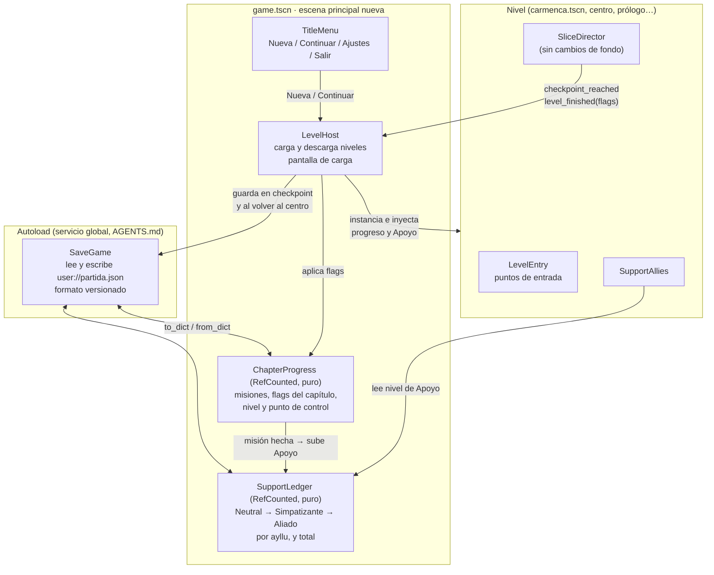

# F8 · Diseño técnico de la base del capítulo (tarea 1)

**Estado:** aprobado por el desarrollador el 2026-11-24.

Cómo se construyen el cambio de escena, la partida guardada, el estado del capítulo y el
Apoyo, sin reescribir lo que funciona (AGENTS.md, regla 5).

## 1. Punto de partida

- **Arranque:** `main.tscn` instancia `carmenca.tscn` y nada más. Cada nivel lleva sus propios
  sistemas: jugador, cámara, director, diálogos, códice, HUD y resumen.
- **Progreso:** el `SliceFlow` guarda los *flags* del nivel en memoria, y se pierden al salir.
  Reiniciar recarga la escena (`reload_current_scene`).
- **El único autoload** es `Settings` (ajustes).
- **Lo que lee los *flags*:** `SupportAllies` y `SessionSummary` leen *flags* del director
  (`llamas_freed`).

## 2. Propuesta



### 2.1. Qué es cada pieza

| Pieza | Tipo | Responsabilidad | Datos en `.tres` |
| --- | --- | --- | --- |
| `SaveGame` | **Autoload** (guardado: permitido por AGENTS.md) | Leer y escribir la partida en `user://partida.json` con `version`. Si el archivo está corrupto o es de otra versión, lo aparta a `partida.bak` y avisa. No sabe nada de misiones: guarda diccionarios | — |
| `game.tscn` | Escena principal nueva | El «armazón»: menú de título, `LevelHost` y pantalla de carga. Vive toda la partida | — |
| `LevelHost` | Nodo del armazón | Cargar un nivel en segundo plano (`ResourceLoader.load_threaded_request`), mostrar la carga, quitar el anterior y meter el nuevo. Elegir el punto de entrada e inyectar el progreso y el Apoyo. Reiniciar desde el punto de control, en lugar de recargar la escena | `ChapterData`: los niveles por id |
| `ChapterProgress` | `RefCounted` puro | Estado de las misiones (bloqueada, disponible, en curso, hecha), condiciones («2 de 3»), *flags* del capítulo, nivel actual y punto de control | `ChapterData` y `MissionData`: id, nivel, ayllu, qué la abre, qué *flag* la completa |
| `SupportLedger` | `RefCounted` puro | Apoyo por ayllu y total. Sube con las misiones y avisa con una señal | `AylluData`: id, nombre (`tr`), umbrales |
| `LevelEntry` | Nodo en cada nivel | Marcadores de entrada con nombre (`from_hub`, `checkpoint_X`), y la señal `level_finished(flags)` | — |

**Por qué no hay más autoloads:** AGENTS.md los limita a «guardado, eventos, ajustes». El
cambio de escena y el estado viven en el armazón, que dura toda la partida, y se inyectan en
cada nivel con `@export` o con un método `setup()`. Así no hay `get_node()` a otros sistemas
ni estado global escondido.

### 2.2. Cómo encaja con lo que existe

- **`SliceDirector`** apenas cambia:
  - emite `level_finished` con sus *flags* al terminar;
  - acepta `restore(step_index, flags)` para continuar una partida desde un punto de
    control;
  - en el armazón, el reinicio con R lo hace `LevelHost`. Fuera del armazón sigue como hoy.
- **`SliceFlow`:** se añade `restore()` y una lectura de sus *flags*; el resto no cambia.
- **`SupportAllies`:** lee «¿hay Apoyo suficiente de este ayllu?» de `SupportLedger` si se le
  inyecta. Si no, el *flag* `llamas_freed`, como hoy.
- **`carmenca.tscn` sigue funcionando sola,** sin armazón. La usan las pruebas, el benchmark,
  el tráiler y la `0.2-slice` que está en prueba. El armazón la carga como un nivel más.
- **Ajustes** (`Settings`): sin cambios.

### 2.3. Qué se guarda

```json
{
  "version": 1,
  "chapter": "capitulo_1",
  "level": "carmenca",
  "checkpoint": "Terraces",
  "level_state": { "step": 12, "flags": ["llamas_freed"] },
  "missions": { "carmenca": "done", "llamas": "available" },
  "chapter_flags": ["prologo_visto"],
  "support": { "ayllu_carmenca": 1 },
  "upgrades": ["huaca_carmenca"],
  "codex": ["huaca"],
  "play_time": 1234.5
}
```

- **Cuándo se guarda:** al llegar a un punto de control, al volver al centro y al salir
  desde la pausa.
- **«Continuar»** carga el nivel guardado en su punto de control.
- **Las mejoras y el códice** pasan del nivel a la partida (hoy se pierden al salir).

### 2.4. Pruebas

- **Lógica pura** (`ChapterProgress`, `SupportLedger`, codificación del guardado): pruebas
  unitarias sin escena, como `SliceFlow`.
- **`SaveGame`:** guardar y cargar, versión antigua, archivo corrupto y archivo ausente, con
  una ruta de prueba en lugar de `user://`.
- **`LevelHost`:**
  - integración de ida y vuelta: título → nivel de prueba → centro → título;
  - «Continuar» tras guardar;
  - ningún nodo huérfano.
- **Tiempo de carga** de Carmenca en el equipo de referencia: se mide y se anota en
  `docs/rendimiento/`.

## 3. Alternativas descartadas

- **Un autoload `Game` con todo el estado:** sería más cómodo, pero es estado global que
  AGENTS.md no permite. Además, complica las pruebas.
- **`change_scene_to_file` sin armazón:** cada nivel tendría que recrear el menú y la carga,
  y el estado tendría que vivir en un autoload.
- **Guardar con `ResourceSaver` (`.tres`):** un archivo de recurso puede ejecutar código al
  cargarse si alguien lo manipula. JSON es más seguro y fácil de versionar.

## 4. Decisiones que se te piden

1. **El armazón con un solo autoload nuevo (`SaveGame`)**, en lugar de varios autoloads.
2. **JSON en `user://partida.json`.** Solo hay una partida; varias ranuras quedan para más
   adelante.
3. **Que `game.tscn` pase a ser la escena principal.** `carmenca.tscn` sigue jugable por
   separado, para pruebas y herramientas.
